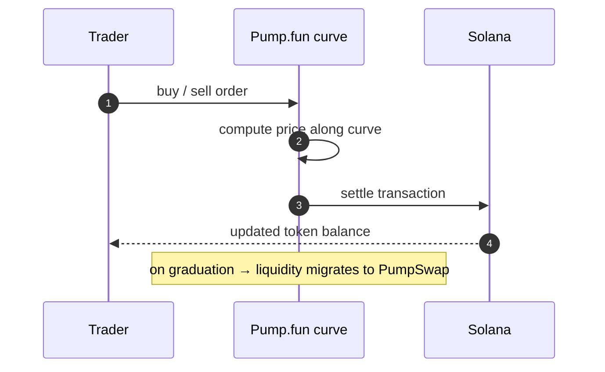
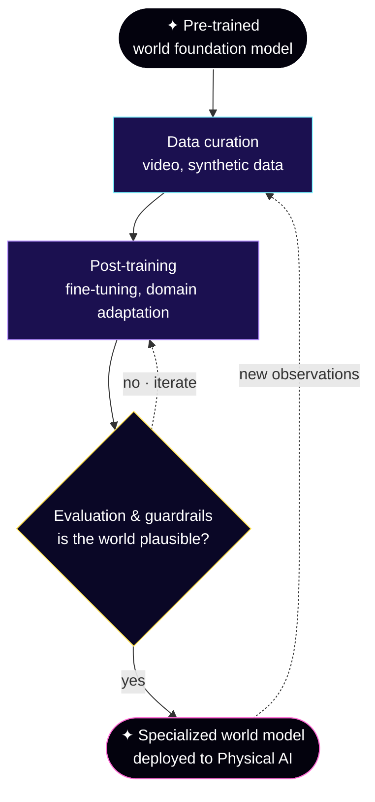
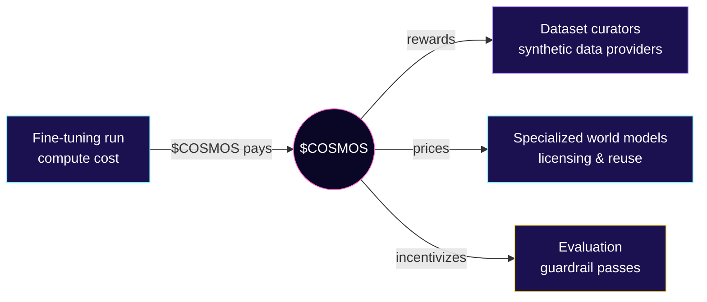

```markdown
# $COSMOS — The Currency of Specialized Worlds
### An experimental token for the world-model specialization economy — built around NVIDIA Cosmos, the frontier open platform to build, specialize and deploy world models faster for Physical AI

<div align="center">


<br/>

</div>

> **NVIDIA Cosmos is a frontier open platform** — world foundation models, tokenizers, data pipelines and post-training tools built to help developers **build, specialize and deploy world models faster** for Physical AI: robots, autonomous vehicles, machines that must understand physical reality.
>
> **$COSMOS is the experiment on top of that question**: what if the specialization of world models had its own currency? A token on Solana, launched through Pump.fun, currently in its **blockchain testing phase**. The hypothesis: one day, $COSMOS could circulate inside the specialization workflows themselves — paying for fine-tuning runs, pricing synthetic data, licensing specialized world models.
>
> **Test wallet referenced by the experiment:**
> `NVDAENbNDqbvFSNNJizspxxEYzEMhriKtTksvLjHpaQ`
>
> This wallet belongs to the $COSMOS community project. The address prefix is a nod to NVIDIA — the home of world models.

---

## Table of Contents

1. [What NVIDIA Cosmos Actually Is](#1-what-nvidia-cosmos-actually-is)
2. [The Question $COSMOS Asks](#2-the-question-cosmos-asks)
3. [Why GitHub?](#3-why-github)
4. [What Is $COSMOS?](#4-what-is-cosmos)
5. [How the Token Works](#5-how-the-token-works)
6. [Specializing a World Model](#6-specializing-a-world-model)
7. [The Specialization Economy](#7-the-specialization-economy)
8. [The Experimental Role of the Token](#8-the-experimental-role-of-the-token)
9. [Why Solana?](#9-why-solana)
10. [The Lore](#10-the-lore)
11. [The Experiment](#11-the-experiment)
12. [The Road to Integration](#12-the-road-to-integration)
13. [Final Transmission](#13-final-transmission)

---

## 1. What NVIDIA Cosmos Actually Is

Let's be precise, because this project only makes sense if the foundation is real.

NVIDIA Cosmos is **not** a sci-fi universe generator. It is an **open platform** released to solve a concrete engineering problem: teaching Physical AI systems — robots, humanoids, autonomous vehicles — to understand, predict and act in the physical world is slow and expensive, because it requires massive amounts of video data and physically plausible simulation.

Cosmos attacks this problem with a full stack:

| Component | What it does |
|---|---|
| **World foundation models** | Pre-trained models that understand physical dynamics — predicting how a scene evolves, generating video of physically plausible worlds |
| **Tokenizers** | Compress video into tokens machines can learn from, the interface between reality and models |
| **Data pipelines** | Curation and processing of massive video datasets for post-training |
| **Post-training tools** | Fine-tuning and adversarial techniques to **specialize** a pre-trained world model for a specific domain |
| **Guardrails & evaluation** | Keeping generated worlds plausible, consistent and safe |

The key word — the one this entire project orbits around — is **specialize**.

A pre-trained world model knows *general* physics. A **specialized** world model knows *your* world: your warehouse, your robot's gripper, your city's streets, your autonomous vehicle's corner cases. Specialization is where world models go from research demos to deployable Physical AI.

> **Build, specialize, deploy — faster. That is NVIDIA Cosmos.**

---

## 2. The Question $COSMOS Asks

NVIDIA Cosmos answers: *how do we specialize world models faster?*

$COSMOS asks the question that comes after:

> *What is a specialized world model worth? And what currency should move through the economy that creates them?*

Every specialization run consumes compute. Every curated dataset represents effort. Every domain-specific world model — the forklift-world, the highway-at-night-world, the warehouse-bin-world — is an asset someone built and someone else needs.

| Layer | What it is | Nature |
|---|---|---|
| **The platform** | NVIDIA Cosmos — build, specialize, deploy world models | The open foundation this project is built around |
| **The economy** | Specialized world models, synthetic data, fine-tuning work | What the experiment studies |
| **The token** | `$COSMOS` on Solana via Pump.fun | Experimental currency, blockchain testing phase |
| **The archive** | This GitHub repository | Documentation |

**Welcome to $COSMOS — the experimental currency of the specialization economy.**

---

## 3. Why GitHub?

An experiment without documentation is just noise. This repository acts as a **lab notebook studying a world-model specialization economy**: each folder is a different wing of the lab.

```text
cosmos/
├── platform/          → notes on the Cosmos platform: WFMs, tokenizers, pipelines
├── specialization/    → how fine-tuning, post-training and domain adaptation work
├── datasets/          → synthetic data and curation notes
├── models/            → concept notes on specialized world models
├── economy/           → the token and its experimental role
├── experiments/       → tests, observations and hypotheses
└── logs/              → the history of the experiment
```

| Folder | Meaning | Content type |
|---|---|---|
| `platform/` | The Cosmos stack as documented | Notes, references, links |
| `specialization/` | Post-training, fine-tuning, domain adaptation | Write-ups, concepts |
| `datasets/` | The memory that feeds specialization | Synthetic data notes |
| `models/` | Specialized world models as assets | Concept notes |
| `economy/` | The token layer | Token mechanics |
| `experiments/` | Hypotheses under test | Ideas, write-ups |
| `logs/` | The experiment's history | Changelog, transmissions |

**The platform builds the worlds. Specialization shapes them. This repository records the economics of both.**

---

## 4. What Is $COSMOS?

`$COSMOS` is an **experimental token** on Solana, launched through Pump.fun, whose hypothesis lives inside the NVIDIA Cosmos specialization stack: that world-model specialization — fine-tuning runs, synthetic data, domain-specific world models — could one day have its own native currency.

| ✅ What $COSMOS is | ❌ What $COSMOS is not |
|---|---|
| An experiment around the specialization economy of world models | A formal NVIDIA product or partnership |
| A support currency for the Cosmos ecosystem, in blockchain testing | A key to NVIDIA hardware, compute or AI models |
| Launched and traded via Pump.fun mechanics, priced by market activity | A security, investment contract or yield product |
| A bet that specialization is where Physical AI value concentrates | Already integrated into the Cosmos platform *yet* |

The premise is simple:

> **Specialized world models are becoming assets. We are testing what their currency could look like — on the blockchain, today.**

---

## 5. How the Token Works

The hypothesis lives in the future. The token runs on real blockchain infrastructure, today.

### 5.1 Technical specifications

| Property | Value |
|---|---|
| Name | COSMOS |
| Ticker | `$COSMOS` |
| Blockchain | Solana |
| Token type | SPL-compatible fungible token |
| Launch platform | Pump.fun |
| Initial market mechanism | Bonding curve |
| Post-graduation venue | PumpSwap |
| Contract infrastructure | Standard Solana / Pump.fun programs |
| Utility | Experimental currency for the world-model specialization economy — blockchain testing phase |

### 5.2 Token lifecycle


| Phase | Mechanic |
|---|---|
| **1 · Creation** | The token is created on Solana through Pump.fun. Its **mint** identifies the asset on-chain; holders keep balances in standard Solana token accounts. |
| **2 · Bonding curve** | Early trading happens against Pump.fun's bonding curve. There is **no order book**: the quoted price moves along the curve with every buy and sell. |
| **3 · Graduation** | When the curve hits Pump.fun's graduation threshold, the token can migrate automatically to **PumpSwap**, seeding a liquidity pool. |
| **4 · Secondary trading** | Buyers and sellers then trade through PumpSwap's automated market maker. Price keeps moving with liquidity, demand and activity. |

### 5.3 Bonding curve behaviour

| Action | Effect |
|---|---|
| Buy | Pushes the price **up** the curve |
| Sell | Pushes the price **down** the curve |
| Large trade | Greater price impact / slippage |
| Low reserves | Worse execution |



No separate app, no proprietary trading engine: **the infrastructure is entirely Solana and Pump.fun.**

---

## 6. Specializing a World Model

This is the heart of the project. The cycle NVIDIA Cosmos exists to accelerate:



| Stage | What happens | Why it matters to $COSMOS |
|---|---|---|
| **Build** | Start from a pre-trained world foundation model | The general starting point |
| **Curate** | Prepare domain data — real video, synthetic data | Data is the fuel of specialization |
| **Specialize** | Fine-tune the model on a specific domain | **Where the value concentrates** |
| **Evaluate** | Guardrails, physics checks, plausibility tests | Quality control of a specialized world |
| **Deploy** | The model runs robot and AV simulation, training, testing | A specialized world model in production |

A specialized world model is a strange new kind of asset: it is **knowledge of one world, compressed**. The forklift-world. The night-highway-world. The humanoid-hand-world.

> **General models understand the universe. Specialized models understand *your* universe. Specialization is the product.**

---

## 7. The Specialization Economy

If world-model specialization becomes an industry, it will have roles. Imagine them as the four forces of this economy:

| Force | Codename | Role |
|---|---|---|
| 🔧 **Builders** | *The Architects* | Those who build and maintain world foundation models — the general starting point |
| 🗄️ **Curators** | *The Memory* | Those who curate, label and generate the data that feeds specialization |
| 🧠 **Specialists** | *The Shapers* | Those who run post-training — turning general models into domain experts |
| 🚗 **Deployers** | *The Pilots* | Those who run specialized worlds in production: robotics, AVs, simulation |

Value flows between them:

```text
  Builders create the foundation.
  Curators feed it with data.
  Specialists shape it into a world.
  Deployers put that world to work.
  And each handoff is a transaction.
```

Every fine-tuning run costs compute. Every dataset represents curation effort. Every specialized model can be licensed, reused, improved. **Each handoff in that chain is a transaction — and transactions are where currencies are born.**

---

## 8. The Experimental Role of the Token

Here is the hypothesis, stated plainly. If $COSMOS ever moves from blockchain testing to real integration, it would flow through the specialization stack:



| Use case | How $COSMOS could work |
|---|---|
| **Paying for specialization** | A team requests a fine-tuning run on its domain data; the run is priced and settled in $COSMOS |
| **Rewarding data** | Curators and synthetic-data generators earn $COSMOS for datasets that measurably improve a model |
| **Licensing specialized worlds** | A specialized world model is rented or sold on-chain; $COSMOS is the unit of account |
| **Proving quality** | Evaluation and guardrail passes are recorded, with $COSMOS as the stake or fee |

To be brutally honest about the current state:

| Today | Tomorrow |
|---|---|
| $COSMOS is a community token on Solana, tested on the blockchain | $COSMOS could be the unit of account for fine-tuning, data and specialized models |
| The specialization economy runs on fiat, contracts and compute credits | A machine-native currency could price machine-native assets |

> **World models are machine-native assets. It is not absurd to ask what a machine-native currency for them would look like. That question is the experiment.**

---

## 9. Why Solana?

The specialization economy is hypothetical — for now. But the ledger underneath the token is real.

| Solana handles | NVIDIA Cosmos handles |
|---|---|
| Token ownership and balances | World foundation models |
| Transactions and transfers | Specialization and post-training |
| On-chain trading activity | Synthetic data generation |
| Publicly verifiable token data | Physically plausible worlds |
| Integration with the Pump.fun ecosystem | Deployment to Physical AI |

**The worlds run on NVIDIA compute. The experiment runs on Solana. Together, they are $COSMOS.**

---

## 10. The Lore

> At first, there were cameras. Rivers of video, terabytes of reality flowing past machines that could see but not understand.
>
> Then came the foundation models — trained on the physics of everything: gravity, friction, light, motion.
>
> The general models understood the universe. But no robot works in "the universe." A forklift works in a warehouse. A car works on a highway. A hand works on a part.
>
> So the shapers began the real work: **specialization**. Each fine-tuning run carved a general model into an expert of one world. Each dataset taught it that world's details. Each evaluation asked: *does this world behave?*
>
> Worlds multiplied. Warehouse-worlds. Highway-worlds. Bin-picking-worlds. Each one compressed knowledge, each one built with compute and data, each one worth something to someone.
>
> And somewhere in the process, someone created a token — because an economy of specialized worlds eventually needs a way to price them.
>
> The platform became its **foundation**.
> The blockchain became its **ledger**.
> And $COSMOS became its **experimental currency**.
>
> Nobody knows how specialized world models will be traded. Nobody knows what a machine-native asset market looks like.
>
> *Perhaps we're about to find out.*

---

## 11. The Experiment

This repository is a creative and economic experiment at the intersection of:

| Domain | Role in the project |
|---|---|
| World foundation models | Core inspiration — NVIDIA Cosmos |
| Model specialization / post-training | The specific process the token hypothesizes about |
| Physical AI — robotics & autonomous vehicles | The end users of specialized worlds |
| Synthetic data | The fuel of specialization |
| Blockchain technology | The real ledger |
| Internet culture & meme economics | How the token actually lives today |

It uses the language of machine learning, open-source development and economics to wrap a serious question in a playful asset:

> **If world-model specialization becomes an industry, what is its currency?**

---

## 12. The Road to Integration

$COSMOS is currently in its **blockchain testing phase**. The honest roadmap:

| Phase | Status | Description |
|---|---|---|
| **1 · Launch** | ✅ Done | Token live on Solana via Pump.fun |
| **2 · Community** | 🔄 In progress | Building the community around the specialization economy thesis |
| **3 · Testing** | 🔄 Current phase | $COSMOS tested on the blockchain as the currency layer of the experiment |
| **4 · Integration** | 🔮 Future | $COSMOS used in world-model specialization workflows — pricing fine-tuning, data and specialized models |
| **5 · The Machine Economy** | 🔮 Future | Specialized world models priced, licensed and traded natively by machines |

> **One day, the machines that specialize worlds could price their own work — in $COSMOS. Today, we test on the blockchain. Tomorrow, the models transact.**

---

## 13. Final Transmission

```text
  The internet gave us information.
  Foundation models gave machines the ability to reason.
  World models are giving machines the ability to understand
  and simulate physical reality.

  But a general world model is only a beginning.
  The real work is specialization —
  carving general physics into worlds that work:
  for a robot, a vehicle, a warehouse, a city.

  And somewhere on Solana, an experimental token is
  asking what that specialization is worth.
```

<div align="center">

### **$COSMOS**

*Every world model is built.*<br/>
*Every specialization has a cost.*<br/>
*Every specialized world is worth something.*

<br/>

<br/>

<sub>made with stardust, orbital rings and an unreasonable amount of `#0a0726` · <b>$COSMOS</b> — the currency of specialized worlds</sub>

</div>
```