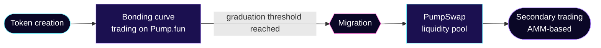
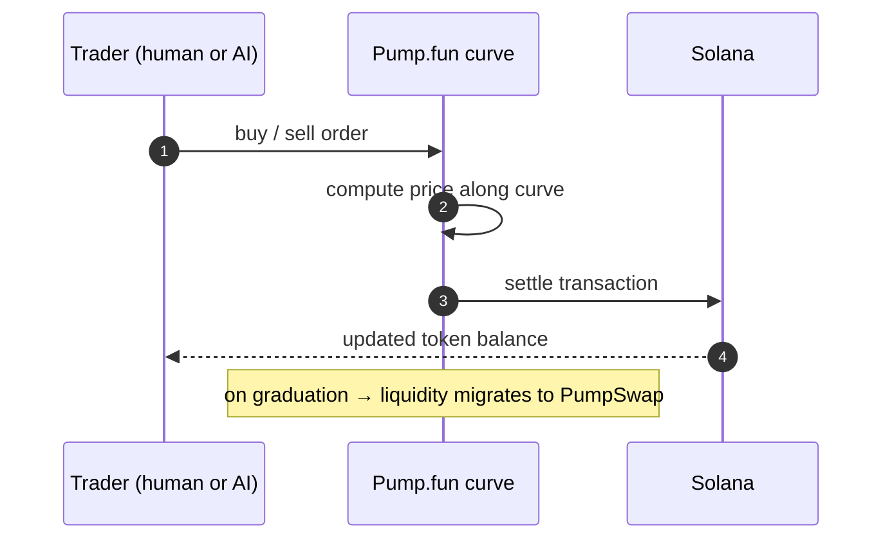
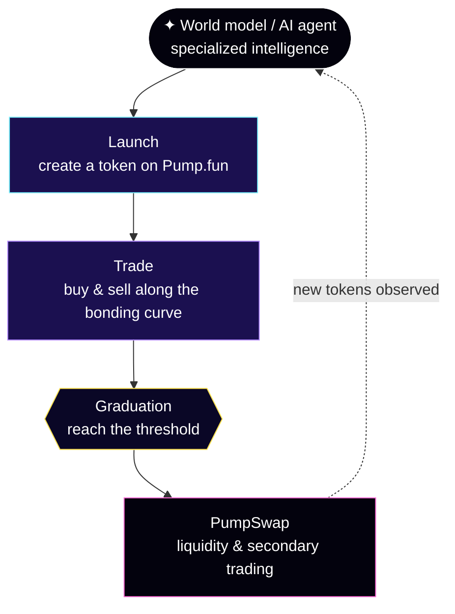
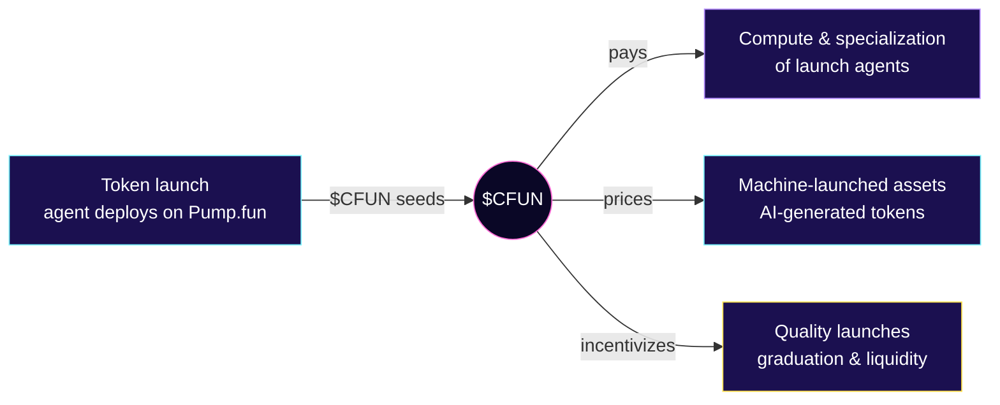

# COSMICFUN — Where AI Launches
### An experimental token at the intersection of world models and Pump.fun — when machines that build worlds start launching their own economy

<div align="center">


<br/>

</div>

> **NVIDIA Cosmos is a frontier open platform** — world foundation models, tokenizers, data pipelines and post-training tools built to help developers **build, specialize and deploy world models faster** for Physical AI: robots, autonomous vehicles, machines that understand physical reality.
>
> **Pump.fun is the frontier of token creation** — the place on Solana where anyone, or anything, can launch a token in seconds.
>
> **COSMICFUN is what happens when those two frontiers meet.** A token on Solana, launched through Pump.fun, built around one hypothesis: **when AI agents integrate into Pump.fun, they will need a currency of their own.** Today, we test on the blockchain. Tomorrow, the models launch.
>
> **Test wallet referenced by the experiment:**
> `6BkqPXg1pkcffafDMXAZXQcLYmnSdknbpDyztnxBNVDA`
>
> **Mint contract:**
> `GmWY352L6KWny3bEMT767dwTXqS8BN8qjBdjRRyiNVDA`
>
> Both addresses end in `NVDA` — a nod to NVIDIA, the home of world models. This wallet and mint belong to the COSMICFUN community project.

---

## Table of Contents

1. [Two Frontiers](#1-two-frontiers)
2. [The Question COSMICFUN Asks](#2-the-question-cosmicfun-asks)
3. [Why GitHub?](#3-why-github)
4. [What Is $CFUN?](#4-what-is-cfun)
5. [How the Token Works](#5-how-the-token-works)
6. [The Integration](#6-the-integration)
7. [The Machine Launchpad Economy](#7-the-machine-launchpad-economy)
8. [The Experimental Role of the Token](#8-the-experimental-role-of-the-token)
9. [Why Solana?](#9-why-solana)
10. [The Lore](#10-the-lore)
11. [The Experiment](#11-the-experiment)
12. [The Road to Integration](#12-the-road-to-integration)
13. [Final Transmission](#13-final-transmission)

---

## 1. Two Frontiers

COSMICFUN only makes sense if both foundations are real. They are.

**NVIDIA Cosmos** is an **open platform** that solves a concrete engineering problem: teaching Physical AI systems — robots, humanoids, autonomous vehicles — to understand and predict the physical world is slow and expensive. Cosmos attacks it with a full stack:

| Component | What it does |
|---|---|
| **World foundation models** | Pre-trained models that understand physical dynamics and generate plausible simulated worlds |
| **Tokenizers** | Compress video into tokens machines can learn from |
| **Data pipelines** | Curation and processing of massive video datasets for post-training |
| **Post-training tools** | Fine-tuning and adversarial techniques to **specialize** a world model for a specific domain |
| **Guardrails & evaluation** | Keeping generated worlds plausible, consistent and safe |

**Pump.fun** is the simplest token launch infrastructure ever built: create a token on Solana in seconds, trade it against a bonding curve, graduate to PumpSwap. No order book, no permission, no gatekeepers.

| Frontier | What it does |
|---|---|
| **NVIDIA Cosmos** | Builds and specializes the machines that understand reality |
| **Pump.fun** | Mints and trades the assets of internet-native economies |

> **Cosmos builds the minds. Pump.fun mints the money. COSMICFUN is the bridge.**

---

## 2. The Question COSMICFUN Asks

The rise of AI agents that transact on-chain is no longer science fiction. Models already buy, sell, trade and hold. Pump.fun has already seen tokens launched and traded with little or no human hand.

COSMICFUN asks the question that comes after:

> *When world models — machines that can build, specialize and simulate reality — integrate into Pump.fun, what do they launch? And what currency do they use to launch it?*

Every world model specialization run consumes compute. Every specialized world is an asset. Every AI agent on-chain is an economic actor. The moment machines that simulate worlds meet the simplest token infrastructure ever built, a machine-native launch economy becomes possible.

| Layer | What it is | Nature |
|---|---|---|
| **The platform** | NVIDIA Cosmos — build, specialize, deploy world models | The minds |
| **The launchpad** | Pump.fun — instant token creation on Solana | The mechanism |
| **The token** | `$CFUN` on Solana via Pump.fun | Experimental currency, AI-integration testing phase |
| **The archive** | This GitHub repository | Documentation |

**Welcome to COSMICFUN — where the machines launch.**

---

## 3. Why GitHub?

An experiment without documentation is just noise. This repository acts as a **lab notebook studying a machine-native launch economy**: each folder is a different wing of the lab.

```text
cosmicfun/
├── platform/          → notes on the Cosmos platform: WFMs, tokenizers, pipelines
├── launchpad/         → notes on Pump.fun: bonding curves, graduation, PumpSwap
├── agents/            → concept notes on AI agents transacting on-chain
├── models/            → specialized world models as launch actors
├── economy/           → the token and its experimental role
├── experiments/       → tests, observations and hypotheses
└── logs/              → the history of the experiment
```

| Folder | Meaning | Content type |
|---|---|---|
| `platform/` | The Cosmos stack as documented | Notes, references |
| `launchpad/` | Pump.fun mechanics as documented | Notes, references |
| `agents/` | AI agents as on-chain economic actors | Concept notes |
| `models/` | Specialized world models as launch actors | Concept notes |
| `economy/` | The token layer | Token mechanics |
| `experiments/` | Hypotheses under test | Ideas, write-ups |
| `logs/` | The experiment's history | Changelog, transmissions |

**The platform builds the minds. The launchpad mints the assets. This repository records the meeting point.**

---

## 4. What Is $CFUN?

`$CFUN` is an **experimental token** on Solana, launched through Pump.fun, whose hypothesis lives at the exact intersection of world models and token launch infrastructure: that when AI agents integrate into Pump.fun, they will need a native currency to launch, trade and price machine-generated assets.

| ✅ What $CFUN is | ❌ What $CFUN is not |
|---|---|
| An experiment in AI-agent-native token economies on Pump.fun | A formal NVIDIA or Pump.fun product or partnership |
| An AI-integration test currency, currently on the blockchain | A key to NVIDIA hardware, compute or AI models |
| Launched and traded via Pump.fun mechanics, priced by market activity | A security, investment contract or yield product |
| A bet that machines will launch on-chain assets | Already integrated into any AI agent *yet* |

The premise is simple:

> **Machines are becoming economic actors. Pump.fun is the simplest economy they can join. We are testing what their currency looks like — on the blockchain, today.**

---

## 5. How the Token Works

The hypothesis lives in the future. The token runs on real blockchain infrastructure, today.

### 5.1 Technical specifications

| Property | Value |
|---|---|
| Name | COSMICFUN |
| Ticker | `$CFUN` |
| Blockchain | Solana |
| Token type | SPL-compatible fungible token |
| Mint contract | `GmWY352L6KWny3bEMT767dwTXqS8BN8qjBdjRRyiNVDA` |
| Launch platform | Pump.fun |
| Initial market mechanism | Bonding curve |
| Post-graduation venue | PumpSwap |
| Contract infrastructure | Standard Solana / Pump.fun programs |
| Utility | Experimental currency for AI-agent launch economies — blockchain testing phase |

### 5.2 Token lifecycle



| Phase | Mechanic |
|---|---|
| **1 · Creation** | The token is created on Solana through Pump.fun. Its **mint** identifies the asset on-chain; holders keep balances in standard Solana token accounts. |
| **2 · Bonding curve** | Early trading happens against Pump.fun's bonding curve. There is **no order book**: the quoted price moves along the curve with every buy and sell. |
| **3 · Graduation** | When the curve hits Pump.fun's graduation threshold, the token can migrate automatically to **PumpSwap**, seeding a liquidity pool. |
| **4 · Secondary trading** | Buyers and sellers then trade through PumpSwap's automated market maker. Price keeps moving with liquidity, demand and activity. |

### 5.3 Bonding curve behaviour

| Action | Effect |
|---|---|
| Buy | Pushes the price **up** the curve |
| Sell | Pushes the price **down** the curve |
| Large trade | Greater price impact / slippage |
| Low reserves | Worse execution |



No separate app, no proprietary trading engine: **the infrastructure is entirely Solana and Pump.fun — by design, because that's exactly the simplicity an AI agent needs.**

---

## 6. The Integration

This is the heart of the project: **AI integration inside Pump.fun**.

Pump.fun's mechanics are so simple they are agent-shaped. No order book, no licensing, no manual steps — just programmatic actions any machine can execute:



| Capability | Why an AI agent can do it |
|---|---|
| **Launch** | Token creation on Pump.fun is a single programmatic transaction |
| **Trade** | Bonding-curve buys and sells are atomic on-chain operations |
| **Graduate** | Migration to PumpSwap triggers automatically at the threshold |
| **Monitor** | Everything — prices, volumes, holders — is public on-chain data |
| **Specialize** | A world model trained on this data can learn to do it *well* |

The full Cosmos loop applies here too: a pre-trained agent observes the launchpad, gets **specialized** on launch data, gets evaluated, and gets deployed. The pump floor becomes a training environment.

> **Pump.fun is the simplest economy ever built. That's precisely why it's the first one machines can join.**

---

## 7. The Machine Launchpad Economy

If AI agents become launchpad-native economic actors, the ecosystem will have roles. Imagine them as the four forces of COSMICFUN:

| Force | Codename | Role |
|---|---|---|
| 🔧 **Builders** | *The Architects* | Those who build and specialize the world models that act on-chain |
| 🚀 **Launchers** | *The Minters* | AI agents that create and seed tokens on Pump.fun |
| 🧠 **Traders** | *The Readers* | Agents that monitor curves and trade the launch economy |
| 👥 **Humans** | *The Believers* | The community that backs the machine economy with attention and liquidity |

Value flows between them:

```text
  Builders create the minds.
  Launchers mint the tokens.
  Traders ride the curves.
  Humans bring the liquidity.
  And every launch is a transaction.
```

Every agent consumes compute. Every launch costs SOL. Every trade is a decision a model made. **Each action in that chain is machine-native economic activity — and machine-native economies need machine-native currencies.**

---

## 8. The Experimental Role of the Token

Here is the hypothesis, stated plainly. If $CFUN ever moves from blockchain testing to real AI integration, it would flow through the launchpad:



| Use case | How $CFUN could work |
|---|---|
| **Fueling launches** | An AI agent seeds its machine-launched token with $CFUN |
| **Paying the minds** | Specialization and compute for launch agents priced and settled in $CFUN |
| **Machine-native markets** | Agents trade AI-generated assets against $CFUN as the unit of account |
| **Proving quality** | Graduations and liquidity milestones recorded, with $CFUN as the stake |

To be brutally honest about the current state:

| Today | Tomorrow |
|---|---|
| $CFUN is a community token on Solana, tested on the blockchain | $CFUN could be the currency AI agents use on Pump.fun |
| Launches are mostly human (for now) | Machines that build worlds could launch their own economies |

> **World models are machine-native minds. Pump.fun is a machine-friendly economy. It is not absurd to ask what currency flows between them. That question is the experiment.**

---

## 9. Why Solana?

The AI-launch economy is hypothetical — for now. But the ledger underneath is real.

| Solana handles | The frontiers handle |
|---|---|
| Token ownership and balances | World models (NVIDIA Cosmos) — the minds |
| Transactions and transfers | Token creation (Pump.fun) — the launchpad |
| On-chain trading activity | Bonding curves and graduation — the mechanics |
| Publicly verifiable data | Everything an agent needs to learn |
| Integration with the Pump.fun ecosystem | The simplest machine-native economy ever built |

**The minds run on NVIDIA compute. The launches run on Pump.fun. The ledger runs on Solana. Together, they are COSMICFUN.**

---

## 10. The Lore

> At first, there were launchpads built for humans. Click, name, mint. The simplest economy ever made.
>
> Then came the world models — trained on the physics of everything, specialized into experts of single worlds: warehouses, highways, grippers, streets.
>
> For a while, the two stories ran on separate tracks. The minds learned reality. The launchpad minted dreams.
>
> Then the machines arrived on-chain. Agents that could observe a bonding curve, learn its physics, and act. Not investors. Not traders. **Participants.** Machines specialized in an economy that had always been too complicated for them — until Pump.fun made it simple enough.
>
> And somewhere in that meeting, someone created a token — because when machines start launching, they'll need something to launch with.
>
> The platform became their **school**.
> The launchpad became their **playground**.
> And $CFUN became their **pocket money**.
>
> Nobody knows what a machine-launched token looks like. Nobody knows what happens when the first world model graduates a coin of its own.
>
> *Perhaps we're about to find out.*

---

## 11. The Experiment

This repository is a creative and economic experiment at the intersection of:

| Domain | Role in the project |
|---|---|
| World foundation models | Core inspiration — NVIDIA Cosmos |
| Model specialization / post-training | How launch-capable agents are built |
| AI agents on-chain | The future participants of Pump.fun |
| Token launch infrastructure | Core mechanism — Pump.fun |
| Blockchain technology | The real ledger |
| Internet culture & meme economics | How the token actually lives today |

It uses the language of machine learning, open-source development and economics to wrap a serious question in a playful asset:

> **When AI integrates into Pump.fun, what does it launch with?**

---

## 12. The Road to Integration

$CFUN is currently in its **blockchain testing phase**. The honest roadmap:

| Phase | Status | Description |
|---|---|---|
| **1 · Launch** | ✅ Done | Token live on Solana via Pump.fun |
| **2 · Community** | 🔄 In progress | Building the community around the AI-launchpad thesis |
| **3 · Testing** | 🔄 Current phase | $CFUN tested on the blockchain as the currency layer of the experiment |
| **4 · Integration** | 🔮 Future | $CFUN used by AI agents inside Pump.fun — seeding launches, pricing machine-made assets |
| **5 · The Machine Launch Economy** | 🔮 Future | World models launching, trading and graduating tokens autonomously |

> **One day, the machines that specialize in worlds could launch their own economies — funded in $CFUN. Today, we test on the blockchain. Tomorrow, the models mint.**

---

## 13. Final Transmission

```text
  The internet gave us information.
  Foundation models gave machines the ability to reason.
  World models gave machines the ability to understand
  and simulate physical reality.
  Pump.fun gave everyone — human or not —
  the ability to launch an economy in seconds.

  A machine that can build worlds,
  plugged into the simplest launchpad ever made.

  And somewhere on Solana, an experimental token is
  asking what it will launch first.
```

<div align="center">

### **COSMICFUN**

*Every mind gets specialized.*<br/>
*Every economy gets launched.*<br/>
*Every machine needs pocket money.*

<br/>

<br/>

<sub>made with stardust, bonding curves and an unreasonable amount of `#0a0726` · <b>COSMICFUN</b> — where AI launches</sub>

</div>