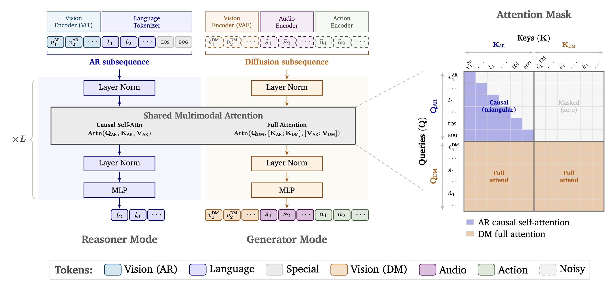

# Model Reference

## Family

Three base models are the product:

| Base model | Size | Primary capability |
|---|---|---|
| [Cosmos3-Edge](https://huggingface.co/nvidia/Cosmos3-Edge) | 4B | Compact omnimodal world model for on-device and low-latency deployment |
| [Cosmos3-Nano](https://huggingface.co/nvidia/Cosmos3-Nano) | 16B | Omnimodal world model — understanding, simulation, prediction, action reasoning on a single GPU |
| [Cosmos3-Super](https://huggingface.co/nvidia/Cosmos3-Super) | 64B | Frontier-scale omnimodal world model |

Post-trained example checkpoints ([cosmos3-examples](https://huggingface.co/collections/nvidia/cosmos3-examples)) demonstrate what [post-training with Cosmos Framework](https://nvda.ws/4zRE0Md) can specialize Cosmos for:

| Example checkpoint | Base | Demonstrates |
|---|---|---|
| [Cosmos3-Nano-Sim-Auto&nbsp;](https://huggingface.co/nvidia/Cosmos3-Nano-Sim-Auto) | Nano | Closed-loop driving simulation: multi-view camera video and LiDAR |
| [Cosmos3-Nano-Transfer-Auto&nbsp;](https://huggingface.co/nvidia/Cosmos3-Nano-Transfer-Auto) | Nano | Multi-view driving video SDG, up to 11 cameras plus LiDAR |
| [Cosmos3-Nano-Sim-Bimanual&nbsp;](https://huggingface.co/nvidia/Cosmos3-Nano-Sim-Bimanual) | Nano | Closed-loop simulation - action-conditioned auto-regressive roll-out |
| [Cosmos3-Nano-Sim-Transfer&nbsp;](https://huggingface.co/nvidia/Cosmos3-Nano-Sim-Transfer) | Nano | Auto-regressive transfer with depth, segmentation, edge, and blur controls |
| [Cosmos3-Super-Text2Image](https://huggingface.co/nvidia/Cosmos3-Super-Text2Image) | Super | Elite quality text-to-image |
| [Cosmos3-Super-Text2Image-4Step](https://huggingface.co/nvidia/Cosmos3-Super-Text2Image-4Step) | Super | Elite quality text-to-image, 17-25x faster |
| [Cosmos3-Super-Image2Video](https://huggingface.co/nvidia/Cosmos3-Super-Image2Video) | Super | Elite quality image-to-video |
| [Cosmos3-Super-Image2Video-4Step](https://huggingface.co/nvidia/Cosmos3-Super-Image2Video-4Step) | Super | Elite quality image-to-video, 17-25x faster |
| [Cosmos3-Nano-Policy-DROID](https://huggingface.co/nvidia/Cosmos3-Nano-Policy-DROID) | Nano | Open SOTA DROID robot policy, runs on RTX Pro 6000 |
| [Cosmos3-Edge-Policy-DROID](https://huggingface.co/nvidia/Cosmos3-Edge-Policy-DROID) | Edge | DROID robot policy at edge-deployable scale |

## Architecture

Cosmos 3 is built on a unified Mixture-of-Transformers (MoT) architecture combining an autoregressive transformer (reasoning; causal self-attention, next-token prediction) with a diffusion transformer (generation; full attention over noisy image/video/audio/action tokens). Both modes share transformer weights, multimodal attention layers, and a unified 3D mRoPE that encodes spatial and temporal structure across modalities.

## Input / output and workflows

<table width="100%">
  <thead>
    <tr>
      <th align="center" width="16%">Workflow</th>
      <th align="center" width="24%">Input</th>
      <th align="center" width="20%">Output Cosmos3-Super</th>
      <th align="center" width="20%">Output Cosmos3-Nano</th>
      <th align="center" width="20%">Output Cosmos3-Edge</th>
    </tr>
  </thead>
  <tbody>
    <tr><td align="center">t2v</td><td align="center">Text</td><td align="center">Video (256p, 480p, 720p)</td><td align="center">Video (256p, 480p, 720p)</td><td align="center">Video (256p, 480p)</td></tr>
    <tr><td align="center">t2sv</td><td align="center">Text</td><td align="center">Video with sound (256p, 480p, 720p)</td><td align="center">Video with sound (256p, 480p, 720p)</td><td align="center">Not supported</td></tr>
    <tr><td align="center">i2v — 1st frame</td><td align="center">Text + image (JPG/PNG/JPEG/WEBP)</td><td align="center">Video (256p, 480p, 720p)</td><td align="center">Video (256p, 480p, 720p)</td><td align="center">Video (256p, 480p)</td></tr>
    <tr><td align="center">i2sv</td><td align="center">Text + image (JPG/PNG/JPEG/WEBP)</td><td align="center">Video with sound (256p, 480p, 720p)</td><td align="center">Video with sound (256p, 480p, 720p)</td><td align="center">Not supported</td></tr>
    <tr><td align="center">v2v — transfer</td><td align="center">Text + MP4 video (edge, blur, depth, segmentation map)</td><td align="center">Video (256p, 480p, 720p)</td><td align="center">Video (256p, 480p, 720p)</td><td align="center">Not supported</td></tr>
    <tr><td align="center">v2v — predict</td><td align="center">Text + MP4 video (first 5 frames used, up to ~3 s of conditioning)</td><td align="center">Video (256p, 480p, 720p)</td><td align="center">Video (256p, 480p, 720p)</td><td align="center">Not supported</td></tr>
    <tr><td align="center">t2i</td><td align="center">Text string</td><td align="center">Image (256p, 480p, 720p)</td><td align="center">Image (256p, 480p, 720p)</td><td align="center">Not supported</td></tr>
    <tr><td align="center">Visual reasoning</td><td align="center">Text, MP4 video, image (JPG/PNG/JPEG/WEBP)</td><td align="center">Text</td><td align="center">Text</td><td align="center">Text</td></tr>
    <tr><td align="center">Forward dynamics</td><td align="center">Text, image, video, action</td><td align="center">Video (256p, 480p, 720p)</td><td align="center">Video (256p, 480p, 720p)</td><td align="center">Video (256p, 480p)</td></tr>
    <tr><td align="center">Inverse dynamics</td><td align="center">Text, video</td><td align="center">Action</td><td align="center">Action</td><td align="center">Action</td></tr>
    <tr><td align="center">Action policy</td><td align="center">Text, image, video</td><td align="center">Action, video</td><td align="center">Action, video</td><td align="center">Action, video</td></tr>
  </tbody>
</table>

\* 720p uses 1280×720, 480p uses 832×480, and 256p uses 320×192.\
\* Video conditioning (v2v — predict) uses 5 frames at the matching resolution.\
\* Action conditioning: camera motion (9D) · AV (9D) · egocentric (57D) · single-arm (10D: DROID/UR/Fractal/Bridge/UMI) · dual-arm (20D) · humanoid (29D: AgiBot)\
\* Output format: JPG, MP4, AAC-in-MP4 (stereo 48 kHz), JSON actions, text\
\* Prompt length: < 300 words recommended for world generation

Every workflow has a runnable notebook — see [cookbooks](https://nvda.ws/4hUq6Tm).

### Simulation checkpoints

The four Cosmos Simulation checkpoints are derived from Cosmos3-Nano and have their own inputs and outputs. Recipes: [Cookbook → Simulation](../../COOKBOOK.md#simulation).

| Checkpoint | Input | Output |
|---|---|---|
| [Cosmos3-Nano-Sim-Auto](https://huggingface.co/nvidia/Cosmos3-Nano-Sim-Auto) | Text + world-scenario map control video (lane lines and object cuboids), one stream per camera view and one for LiDAR | Synchronized multi-view video and LiDAR, generated autoregressively in a closed loop; 10–30 FPS, 480p or 720p |
| [Cosmos3-Nano-Transfer-Auto](https://huggingface.co/nvidia/Cosmos3-Nano-Transfer-Auto) | Text + world-scenario map control video (lane lines and object cuboids), one stream per camera view and one for LiDAR | Synchronized multi-view video and LiDAR, up to 300 frames; 10–30 FPS, 480p or 720p |
| [Cosmos3-Nano-Sim-Bimanual](https://huggingface.co/nvidia/Cosmos3-Nano-Sim-Bimanual) | Start image (JPG/PNG/JPEG/WEBP) + per-frame actions and camera movement (JSON); text optional | Video generated frame by frame; up to 901 frames at 30 FPS, 480p |
| [Cosmos3-Nano-Sim-Transfer](https://huggingface.co/nvidia/Cosmos3-Nano-Sim-Transfer) | Text + simulator-rendered control video: depth, segmentation, edge or blur | Photoreal video aligned to the input geometry; up to 600 frames at 30 FPS, 480p |

\* Camera rigs (Sim-Auto, Transfer-Auto): 1-11 views (not including LiDAR), standard and fisheye; other rigs need post-training.\
\* Action embodiment (Sim-Bimanual): AgiBot, YAM.\
\* Sim-Transfer runs up to 8 parallel environments in real time on one GB200.\
\* Test hardware: H100 and B200. Acceleration engines: PyTorch, vLLM-Omni, FlashDreams (for sim-auto and sim-bimanual), SGLang (coming soon).

## Generation settings

| Setting | Supported values |
|---|---|
| Resolution tiers | 256p, 480p, 720p (default 480p) |
| Aspect ratios | 16:9, 4:3, 1:1, 3:4, 9:16 (default 16:9) |
| Frame rates | 10, 16, 24, 30 FPS (default 24) |
| Frame count | 5–300 (default 189) |
| Precision | BF16 tested |
| OS / GPU | Linux; Ampere, Hopper, Blackwell |

\* Cosmos3-Edge supports only 256p and 480p, frame count is 50-150.

## Sampling defaults

**Generator prompt upsampling:** `max_tokens=20000`, `temperature=0.7`, `top_p=0.8`, `top_k=20`, `repetition_penalty=1.0`, `presence_penalty=1.5`, `seed=3407`.

**Reasoner:**

| Parameter | Without reasoning | With reasoning |
|---|---|---|
| `temperature` | 0.7 | 0.6 |
| `top_p` | 0.8 | 0.95 |
| `top_k` | 20 | 20 |
| `presence_penalty` | 1.5 | 0.0 |
| `repetition_penalty` | 1.0 | 1.0 |

## Limitations

Cosmos 3 can produce artifacts in long, high-resolution, or physically complex outputs: temporal inconsistency, unstable camera/object motion, sound-video misalignment, action-state inconsistency, object morphing, inaccurate 3D structure, implausible dynamics. Physically grounded simulation, safety-critical control, and complex multi-agent behavior require additional validation, guardrails, and system-level safety analysis before deployment.
